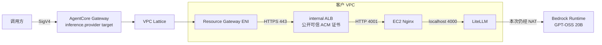

# AgentCore Gateway → 私有 LiteLLM：问题、解决办法与完整演示

自建 LiteLLM 位于 VPC 内部、禁止公网入站时，如何通过 AgentCore Gateway 的 inference target 正常调用？Console 没显示 VPC 选项、文档未列出 inference，容易让人以为只能使用公网 endpoint。

本项目记录一次实际验证：通过创建 API 的顶层 `privateEndpoint.managedVpcResource` 建立 Lattice 连接，在内部 ALB 上使用公开可信 TLS 证书，最终完成真实模型推理、SSE 和后端来源核对。README 同时解释证书域名为什么没有公网 A 记录，以及 `endpoint` 与 `routingDomain` 的区别。

> `examples/` 是实测记录的脱敏副本：账号、域名、资源 ID 已一致替换，部分服务元数据和模型 reasoning 字段已省略。IP、请求标识、状态、模型输出和关联关系保留，方便离线重放验证。示例标识不是可以直接调用的线上资源。

## 1. 结论与“不走外网”的范围

**实测通过：AgentCore Gateway 的 `inference.provider` target 可以通过 `privateEndpoint.managedVpcResource`，经 VPC Lattice 访问 VPC 内部 ALB 后面的 EC2 LiteLLM，完成真实模型推理和 SSE。Gateway → LiteLLM 这一段使用私网，无需公网 ALB、EC2 公网 IP，也无需对公网开放 LiteLLM 的 443 入站。**

本报告的实际验证时间是 **2026-09-30 06:46 UTC**，区域为 **东京 `ap-northeast-1`**。这不仅是 target `READY`，还包含真实请求、响应、后端日志和 Lattice ENI 地址的交叉核对。

| 链路或操作 | 本次实际情况 | 是否属于已验证的“不走外网”范围 |
|---|---|---|
| 测试客户端 → AgentCore Gateway | 使用区域公共 Gateway URL，SigV4 认证 | 否，未验证入站 PrivateLink |
| AgentCore Gateway → VPC 内 LiteLLM | VPC Lattice → 内部 ALB → 私有 EC2 | **是，已验证** |
| LiteLLM → Bedrock 真实模型 | 现有 NAT → Bedrock Runtime 公共服务 endpoint | 否，未部署 Bedrock VPC endpoint |
| EC2 初次安装软件、SSM 管理和读取 Secret | 使用现有子网出站能力 | 不属于推理私网入口验证 |

若要求连模型上游也私网，需要增加 Bedrock Runtime interface VPC endpoint 并另行核对；若要求整个环境从安装开始完全隔离，还需准备私有软件源或预装 AMI，以及相应的管理服务 endpoints。这些扩展未在本次测试中执行。

## 2. 架构和必要组件



- **LiteLLM**：真正运行在私有 EC2 上的代理，使用 master key 认证，映射到真实 Bedrock 模型。
- **内部 ALB**：提供公开可信的 HTTPS 证书。证书公开可信不表示 ALB 对公网开放；ALB 的 scheme 是 `internal`。
- **Nginx**：转发给 LiteLLM，并记录 `x-probe-id`、ALB 写入的来源地址和响应状态；它用于日志核对，不是 AgentCore 的必需组件。
- **VPC Lattice Resource Gateway**：由 AgentCore 根据 `managedVpcResource` 自动管理，其 ENI 在指定子网内。
- **AgentCore Identity API_KEY provider**：读取专用 Secrets Manager secret；Gateway 在出站方向注入 `Authorization: Bearer <key>`。

关键区别：`provider.endpoint` 使用证书对应的域名；`routingDomain` 使用内部 ALB DNS。后者决定私网目标地址，前者保留正确 TLS SNI/主机名。无需为 provider endpoint 配置指向公网服务的 A 记录。

## 3. 克隆仓库与准备环境

完整源码和脱敏证据都在本仓库。先克隆并准备 Python 环境：

```bash
git clone https://github.com/milan9527/agentcore-gateway-private-litellm.git
cd agentcore-gateway-private-litellm
python3 -m venv .venv
.venv/bin/pip install -r requirements.txt
```

无需 AWS 账号也可先演示证据核对：

```bash
.venv/bin/python replay_evidence.py
```

它在临时目录中执行真实使用过的日志/ENI 关联断言，成功时输出 `Recorded evidence replay passed`。**这只重放已记录证据，不会部署 AWS 资源，也不是新一轮在线测试。**

需要实际部署时：

```bash
aws sts get-caller-identity
cp deployment-config.example.json deployment-config.json
```

将配置中的账号、VPC、子网和域名替换为自己的值。`deployment-config.json`、活动状态和运行日志已加入 `.gitignore`；不要提交凭证。`examples/observed-resources.json` 只记录脱敏历史资源，不能替代新部署生成的 `private-litellm-state.json`。

管理机建议 Python 3.12；部署 API 使用 boto3/botocore **1.43.105**。先前环境中的旧 AWS CLI `2.33.15` 服务模型缺少新 target 字段，因此本次创建使用 SDK。本文涉及的传统 EC2/ELB 查询仍可使用 CLI。

复现前具备：

1. 可使用 AgentCore Gateway inference provider 的区域和 AWS 账号。本次只验证了东京。
2. 同一 VPC 的两个不同可用区子网，用于内部 ALB 和托管 Lattice ENI；至少第一个子网能启动 EC2。
3. VPC DNS 功能正常、子网到私有 EC2 的路由畅通。
4. EC2 首次安装时能获取 Amazon Linux/PyPI 软件包，并能访问 SSM、Secrets Manager 和本次使用的 Bedrock 模型。当前脚本使用既有 NAT；安装后 Gateway → LiteLLM 不依赖 NAT。
5. 一个自己控制 DNS 的域名，用于申请公开可信的 ACM 证书。
6. 操作者有创建本次 EC2、SG、ALB、ACM、Secret、IAM role/profile、AgentCore Gateway/target/provider 的权限，以及 `iam:PassRole`。首次使用 managed VPC 可能还需创建 AgentCore 网络服务关联角色的权限。自动 DNS 模式另需指定 Route 53 zone 的写权限。

这里是部署操作者的权限需求。运行时的 EC2/Gateway 角色权限单独限制，见第 6 节。

## 4. 配置并部署私有 EC2、LiteLLM 和内部 ALB

编辑 `deployment-config.json`，替换为自己的资源：

```json
{
  "expectedAccountId": "123456789012",
  "region": "ap-northeast-1",
  "vpcId": "vpc-0123456789abcdef0",
  "subnetIds": [
    "subnet-0123456789abcdef0",
    "subnet-0123456789abcdef1"
  ],
  "domainSuffix": "example.com",
  "hostedZoneId": null
}
```

`hostedZoneId: null` 表示手动在权威 DNS 中添加 ACM 验证记录。只有 Route 53 确实是该域名的权威 DNS 时，才填入对应 public hosted zone ID。账号里“存在同名 zone”并不代表它已生效；本次域名实际使用阿里云 DNS。

执行：

```bash
.venv/bin/python deploy_private_litellm.py --config deployment-config.json
```

脚本会生成唯一的 `litellm-vpc-xxxxxx` 名称，将资源 ID 和进度保存到 `private-litellm-state.json`，并创建：

1. 该名称下域名的 ACM 证书；打印验证 CNAME。
2. 三个专用安全组，按下面的入站规则连接。
3. Secrets Manager JSON secret，随机生成 master key；API_KEY provider 使用 `apiKeySecretSource: EXTERNAL` 和 `jsonKey: apiKey`。
4. EC2 实例角色、instance profile，以及 **无公网 IP**、IMDSv2 required 的 `t4g.medium` Amazon Linux 2023 EC2，使用 20 GiB 加密 gp3。
5. 内部 ALB、HTTP 4001 target group，健康检查路径 `/health/liveliness`。
6. Gateway 执行角色及 `AWS_IAM` 入站认证的 Gateway。
7. 待证书签发、后端健康后，创建 HTTPS 443 listener 和 inference target。

| 安全组 | 唯一入站规则 | 目的 |
|---|---|---|
| Lattice SG | 无自定义入站规则 | 托管资源接口，通过出站连接后端 |
| ALB SG | TCP 443，来源 Lattice SG | 只接收这条托管私网连接 |
| EC2 SG | TCP 4001，来源 ALB SG | 只接收内部 ALB 转发 |

本次这些 SG 使用默认允许出站配置；**证明实际路径走私网的依据是内部目的地址、限定入站源和 ENI/日志对应关系，不是宣称 VPC 完全禁止出站。** EC2 无 SSH 入站，使用 SSM 管理。

### EC2 上实际安装和运行的内容

完整安装过程在 [litellm_bootstrap.sh](litellm_bootstrap.sh)。关键安装命令：

```bash
dnf install -y python3.12 python3.12-pip nginx
python3.12 -m venv /opt/litellm/venv
/opt/litellm/venv/bin/pip install 'litellm[proxy]==1.103.1' 'prisma==0.15.0' 'boto3==1.43.105'
```

LiteLLM 配置 `/etc/litellm/config.yaml`：

```yaml
model_list:
  - model_name: private-gpt-oss
    litellm_params:
      model: bedrock/converse/openai.gpt-oss-20b-1:0
      aws_region_name: ap-northeast-1
  - model_name: private-network-check
    litellm_params:
      model: openai/network-check
      api_key: unused
      mock_response: "LITELLM_PRIVATE_NETWORK_OK"
general_settings:
  master_key: os.environ/LITELLM_MASTER_KEY
litellm_settings:
  drop_params: true
```

`private-network-check` 是明确的 mock，仅用于网络检查；**真实推理的证据来自 `private-gpt-oss`**。

EC2 用实例角色读取专用 secret，把 key 写入 `/etc/litellm/environment`，权限 `0600`、root 所有。systemd 读取此文件，以 `litellm` 系统用户启动：

```text
/opt/litellm/venv/bin/litellm --config /etc/litellm/config.yaml --host 127.0.0.1 --port 4000
```

Nginx 监听 4001，代理到 `http://127.0.0.1:4000`，关闭响应缓冲以支持 SSE。日志 `/var/log/nginx/private-proof.log` 包含：

```nginx
log_format proof escape=json
  '{"time":"$time_iso8601","peer":"$remote_addr","forwarded_for":"$http_x_forwarded_for","probe_id":"$http_x_probe_id","method":"$request_method","uri":"$uri","status":$status,"upstream_status":"$upstream_status","seconds":$request_time}';
```

不会把 Authorization header 或 API key 写入日志。

## 5. 完成 HTTPS 证书验证

脚本打印以下形态的记录：

```text
Name:  _<token>.litellm-vpc-xxxxxx.<你的域名>
Type:  CNAME
Value: _<token>.acm-validations.aws.
```

将本轮实际值添加到域名的权威 DNS。阿里云控制台通常填写去掉域名后缀的“主机记录”。不要照抄本报告旧 token，新的部署会生成新的验证记录。

脚本会等待 ACM `ISSUED`。如果超过本地等待时间，保留已创建资源，在 DNS 生效后使用相同目录、相同配置重新执行部署命令，继续完成部署。不要为了重试删除状态文件。

本次实际验证记录已添加成功，证书于 **06:34 UTC** 签发。应保留 CNAME 供续期使用。

**不能用 self-signed certificate 代替本方案中的公开可信证书。** ALB 仍是 internal；证书的信任属性和服务的公网可达性是两回事。参见 [AWS 私网 TLS 说明](https://docs.aws.amazon.com/bedrock-agentcore/latest/devguide/vpc-egress-private-endpoints.html#lattice-vpc-egress-private-certs)。

## 6. 配置运行时 IAM 和 API_KEY

这些资源由部署脚本创建；以下说明用于审核和手动复现。

### EC2 角色

Trust principal：`ec2.amazonaws.com`。

权限包括：

- `AmazonSSMManagedInstanceCore`，供 SSM 管理。
- `secretsmanager:GetSecretValue`，仅本次 LiteLLM secret。
- `bedrock:InvokeModel` 和 `bedrock:InvokeModelWithResponseStream`，仅 `arn:aws:bedrock:ap-northeast-1::foundation-model/openai.gpt-oss-20b-1:0`。

### Gateway 角色

Trust principal：`bedrock-agentcore.amazonaws.com`，使用 `aws:SourceAccount` 和本账号区域 `gateway/*` 的 `aws:SourceArn` 条件。

运行时权限：

| Action | 必须覆盖的资源 |
|---|---|
| `bedrock-agentcore:GetWorkloadAccessToken` | `workload-identity-directory/default` 和本 Gateway 的 workload identity |
| `bedrock-agentcore:GetResourceApiKey` | `token-vault/default`、本次 API_KEY provider、`workload-identity-directory/default`、本 Gateway 的 workload identity |
| `secretsmanager:GetSecretValue` | 本次 LiteLLM secret ARN |

完整已验证策略：[gateway-policy.json](examples/evidence/gateway-policy.json)。运行时 API key 获取会对多个资源分别授权；只允许 provider ARN 不足以完成推理。

### API_KEY provider

对应的 SDK 请求结构：

```python
provider = control.create_api_key_credential_provider(
    name=project_name,
    apiKeySecretSource="EXTERNAL",
    apiKeySecretConfig={"secretId": secret_arn, "jsonKey": "apiKey"},
)
```

Secret 是 `{"apiKey": "<随机生成的 LiteLLM master key>"}`。不要把 key 放到调用 Gateway 的客户端、shell 参数或版本库中。

## 7. 创建 inference provider target

使用 `boto3.client("bedrock-agentcore-control", region_name="ap-northeast-1")` 的 `create_gateway_target`。关键请求如下；把尖括号变量替换为本轮状态文件中的值，`clientToken` 使用新的 UUID：

```json
{
  "gatewayIdentifier": "<Gateway ID>",
  "name": "litellm-private",
  "clientToken": "<UUID>",
  "targetConfiguration": {
    "inference": {
      "provider": {
        "endpoint": "https://<证书对应的域名>",
        "operations": [
          {
            "path": "/v1/chat/completions",
            "models": [
              {"model": "private-gpt-oss"},
              {"model": "private-network-check"}
            ]
          }
        ]
      }
    }
  },
  "credentialProviderConfigurations": [
    {
      "credentialProviderType": "API_KEY",
      "credentialProvider": {
        "apiKeyCredentialProvider": {
          "providerArn": "<API_KEY provider ARN>",
          "credentialLocation": "HEADER",
          "credentialParameterName": "Authorization",
          "credentialPrefix": "Bearer"
        }
      }
    }
  ],
  "metadataConfiguration": {"allowedRequestHeaders": ["x-probe-id"]},
  "privateEndpoint": {
    "managedVpcResource": {
      "vpcIdentifier": "<VPC ID>",
      "subnetIds": ["<Subnet A>", "<Subnet B>"],
      "endpointIpAddressType": "IPV4",
      "securityGroupIds": ["<Lattice SG ID>"],
      "routingDomain": "<internal ALB DNS>"
    }
  }
}
```

注意：

- `privateEndpoint` 与 `targetConfiguration` **同级**，不是 `inference.provider` 内部字段。
- `routingDomain` 是内部 ALB DNS，不含 `https://`；provider endpoint 是完整 HTTPS URL，域名匹配 ALB 证书。
- **`credentialPrefix` 为 `"Bearer"`，不要尾部空格。** 本次该配置发出了正确的 `Bearer <key>`。尾部空格配置曾导致模型发现收到无效凭证；本机双空格对照复现了同样的 LiteLLM 错误。
- 创建过程会调用 `/v1/models` 做模型发现，因此后端必须已就绪，key 和权限必须正确。
- 等待 `get_gateway_target` 返回 `READY`，并检查 `privateEndpointManagedResources` 返回的 resource gateway ARN；然后继续数据面验证，不能把 `READY` 当作最终推理成功。

本次成功请求的脱敏副本：[create-target-corrected-request.json](examples/evidence/create-target-corrected-request.json)。

## 8. 验证过程：先本机，再 Gateway，再核对网络来源

### 8.1 本机检查

```bash
.venv/bin/python litellm_ssm.py litellm_local_probe.sh --label local-inference
```

通过 SSM 在 EC2 上执行，期望：不带 key 的 `/v1/models` 返回 `401`；带 key 的 mock 和真实模型推理均返回 `200`。这一步只证明后端可用，不证明 Gateway 路径。

### 8.2 通过 Gateway 发出 SigV4 推理请求

```bash
.venv/bin/python verify_private_litellm.py
```

脚本读取当前目录的 `private-litellm-state.json`，依次发出 mock、真实模型、SSE 三个请求。它只使用操作者 AWS 凭证签名，不读取 LiteLLM key。

调用地址：

```text
https://<gateway-id>.gateway.bedrock-agentcore.ap-northeast-1.amazonaws.com/inference/v1/chat/completions
```

真实推理请求体：

```json
{
  "model": "litellm-private/private-gpt-oss",
  "messages": [{"role": "user", "content": "Reply with exactly: PRIVATE_PATH_OK"}],
  "max_tokens": 256,
  "stream": false
}
```

签名使用 service `bedrock-agentcore`、region `ap-northeast-1`。`litellm-private/` 是 Gateway 的目标限定前缀；LiteLLM 配置的模型名是 `private-gpt-oss`。测试 SSE 时将 `stream` 改为 `true`。

[verify_private_litellm.py](verify_private_litellm.py) 包含完整 Python SigV4 实现。它为每次请求生成唯一 `x-probe-id`，保存请求体、响应体、状态和 request ID，但不保存签名凭证。

### 8.3 获取后端日志和真实网络配置

```bash
.venv/bin/python collect_private_network_evidence.py
.venv/bin/python litellm_ssm.py litellm_access_proof.sh --label access-proof-repeat
.venv/bin/python summarize_private_path.py
```

最后一个脚本自动检查：

1. EC2 `PublicIpAddress` 不存在。
2. ALB `Scheme == internal`。
3. ALB 和 EC2 的入站规则分别只允许 Lattice SG 与 ALB SG。
4. 通过 Lattice SG 查询到真实 ENI 和私有 IP。
5. mock、真实推理、SSE 都有 `200` 响应。
6. 每个 `x-probe-id` 都能在 Nginx 日志中找到对应的 `POST /v1/chat/completions`、`200`，且 `forwarded_for` 匹配 Lattice ENI IP。
7. SSE 包含有效内容和 `[DONE]`。

所有断言通过后才写入 `verified-private-path.json` 和 `gatewayDataPlaneVerified: true`。

也可手工查询本次实际资源：

```bash
aws ec2 describe-instances --region ap-northeast-1 \
  --instance-ids i-00000000000000004 \
  --query 'Reservations[].Instances[].{ID:InstanceId,PrivateIP:PrivateIpAddress,PublicIP:PublicIpAddress}'

aws ec2 describe-network-interfaces --region ap-northeast-1 \
  --filters Name=group-id,Values=sg-00000000000000008 \
  --query 'NetworkInterfaces[].{ENI:NetworkInterfaceId,IP:PrivateIpAddress,Description:Description}'

aws ec2 describe-security-groups --region ap-northeast-1 \
  --group-ids sg-00000000000000007 sg-00000000000000006 \
  --query 'SecurityGroups[].{ID:GroupId,Ingress:IpPermissions}'
```

这些命令中的 ID 已脱敏，只展示查询方法；运行时必须从自己的状态文件取值。

## 9. 本次实测结果（资源标识已脱敏）

| 项目 | 结果 |
|---|---|
| Gateway | `litellm-vpc-demo-demogateway` |
| Target | `litellm-private` / `DEMO000001`，`READY` |
| EC2 | `i-00000000000000004`，`172.31.59.78`，无公网 IP |
| ALB | `internal`，仅允许 Lattice SG 的 443 入站 |
| Lattice resource gateway | `rgw-00000000000000005` |
| Lattice ENI IP | `172.31.59.48`、`172.31.132.175` |
| API_KEY | 由 Gateway 注入，后端诊断确认正确匹配；诊断配置已移除 |

| 测试 | HTTP | 模型内容 | 后端来源 IP |
|---|---|---|---|
| mock 网络检查 | `200` | `LITELLM_PRIVATE_NETWORK_OK` | `172.31.59.48` |
| 真实模型推理 | `200` | `PRIVATE_PATH_OK_inference-bed48286cef1` | `172.31.132.175` |
| SSE | `200` | `PRIVATE_PATH_OK_stream-f8534fef0943`，收到 `[DONE]` | `172.31.132.175` |

真实推理对应的 Nginx 日志（省略临时认证匹配字段）：

```json
{
  "time": "2026-09-30T06:46:25+00:00",
  "peer": "172.31.58.217",
  "forwarded_for": "172.31.132.175",
  "probe_id": "inference-bed48286cef1",
  "method": "POST",
  "uri": "/v1/chat/completions",
  "status": 200,
  "upstream_status": "200",
  "seconds": 0.486
}
```

`peer` 是直接连接 EC2 的 ALB 节点；`forwarded_for` 是 ALB 记录的请求来源，本次与 Lattice ENI `eni-00000000000000001` 的 `172.31.132.175` 一致。测试客户端没有发送自定义 X-Forwarded-For，加上限定的安全组来源，可确认该请求从 Lattice 进入内部 ALB。

实际证据：

- [自动关联后的完整结论](examples/evidence/verified-private-path.json)
- [真实推理请求与响应](examples/evidence/inference-bed48286cef1.json)
- [SSE 完整响应](examples/evidence/stream-f8534fef0943.json)
- [后端访问日志](examples/evidence/access-proof-inference-26599f4e-9330-4cad-84c5-9b9f7d0e2365.json)
- [Lattice ENI](examples/evidence/proof-lattice-network-interfaces.json)
- [安全组](examples/evidence/proof-security-groups.json)
- [脱敏说明与证据索引](examples/README.md)

## 10. 本次排障和复现注意事项

| 现象 | 本次处理 |
|---|---|
| Console 没有 inference VPC 配置入口 | 用新版 boto3 的创建 API，同时提交 `inference.provider` 与顶层 `privateEndpoint` |
| ACM 一直 `PENDING_VALIDATION` | 查明权威 DNS 在阿里云，把 CNAME 添加到真正生效的 DNS；不要只看账号中是否存在 Route 53 zone |
| LiteLLM 无 key 请求返回 500，日志提示缺少 `prisma` | bootstrap 固定安装 `prisma==0.15.0`，随后未认证请求正确返回 401 |
| target 模型发现返回 `400 No connected db` | 本次为认证格式问题；`credentialPrefix` 使用 `Bearer`，不带尾部空格。正确 key 的 `/v1/models` 不依赖数据库即可返回 200 |
| target 已 READY，但推理无法获取 API key | 根据拒绝信息把 workload identity、directory、token vault 和 provider 的 `GetResourceApiKey` 权限补齐 |
| target 失败后 Update 提示私网 association 不可用 | 本次保存失败证据后删除失败 target、重新创建；当前成功 target 是 `DEMO000001` |
| 请求成功却没有可用的私网证据 | 同时核对 `x-probe-id`、后端日志、Lattice ENI IP、ALB scheme 和 SG；不要只依据 READY/200 判定网络路径 |

脚本保存创建进度，支持证书等待后的重跑。新部署应在新的克隆目录中进行，避免复用其他部署的状态文件。测试区域以东京为准，其他区域的模型/服务可用性需另行确认。

实际部署会创建收费的 EC2、EBS、ALB、Secret 和 Lattice 等资源，脚本不会自动删除它们。实验结束后请根据自己的状态文件清理测试资源，保留仍在使用的证书验证记录。

部署脚本已做语法、CLI 帮助和请求结构检查；上述端到端结果来自本次真实 AWS 部署，不把每一个新账号/区域也描述为已经实测。

## 11. 官方语义参考

- [AgentCore VPC Lattice 私网连接、routing domain 和 TLS 要求](https://docs.aws.amazon.com/bedrock-agentcore/latest/devguide/vpc-egress-private-endpoints.html)
- [CreateGatewayTarget API](https://docs.aws.amazon.com/bedrock-agentcore-control/latest/APIReference/API_CreateGatewayTarget.html)
- [Bedrock interface VPC endpoints：用于扩展模型上游私网连接，非本次已验证步骤](https://docs.aws.amazon.com/bedrock/latest/userguide/vpc-interface-endpoints.html)

这里的 inference 私网可用性结论来自请求和数据面证据。公开文档的 target 类型清单、Console 是否展示字段，与本次 API 实测结果应分别判断。

## 12. 常见疑问：域名和 Console 中的 target

### 为什么早期 target 显示 Bedrock Mantle？

最初的 `inference-vpc` target 只用于验证“inference + VPC 配置能否创建”，上游使用 Bedrock Mantle。真实 LiteLLM 演示另建 `litellm-private` target。查看 Console 时，应定位到当前部署状态文件里的 `gatewayId`、`targetId`，避免混淆两组资源。

### `litellm-vpc-xxxxxx.example.com` 在哪里？

这是演示为 LiteLLM 生成的 HTTPS 身份域名，对应内部 ALB 上的 ACM 证书，不代表另有一台公网服务器。

| 配置或记录 | 用途 |
|---|---|
| `inference.provider.endpoint` | 完整 HTTPS URL，提供 TLS SNI/证书校验所用域名 |
| `privateEndpoint.managedVpcResource.routingDomain` | 内部 ALB DNS，提供实际私网路由目标 |
| ACM 验证 CNAME | 证明域名所有权，用于证书签发与续期 |
| EC2 私有 IP | LiteLLM 实际运行位置 |

本次 provider 域名没有公网服务 A 记录，公网浏览器直接访问不会成功。Gateway 使用 routing domain 访问内部 ALB，并使用 provider 域名进行 TLS 校验。公开可信证书与公网可达服务是两个独立条件。

### 这是否等于所有流量都不走公网？

不是。本次已验证的是 **Gateway → LiteLLM**。客户端使用 Gateway 公共入口；LiteLLM 的真实模型上游仍通过 NAT 访问 Bedrock。若要把模型上游也私有化，需要另配 Bedrock Runtime VPC endpoint 并验证该段；这里没有声称已经完成。
